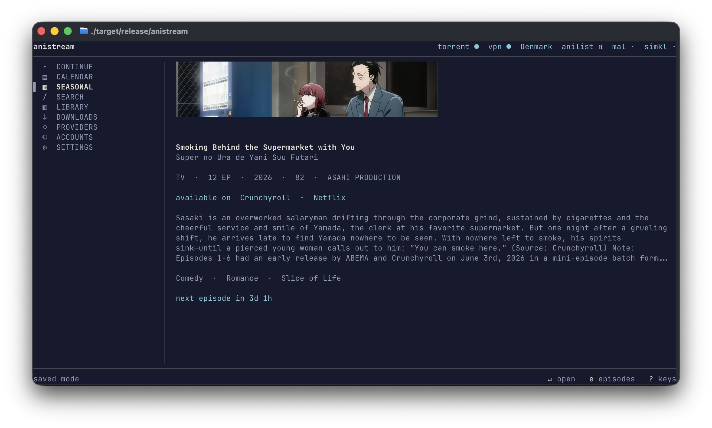
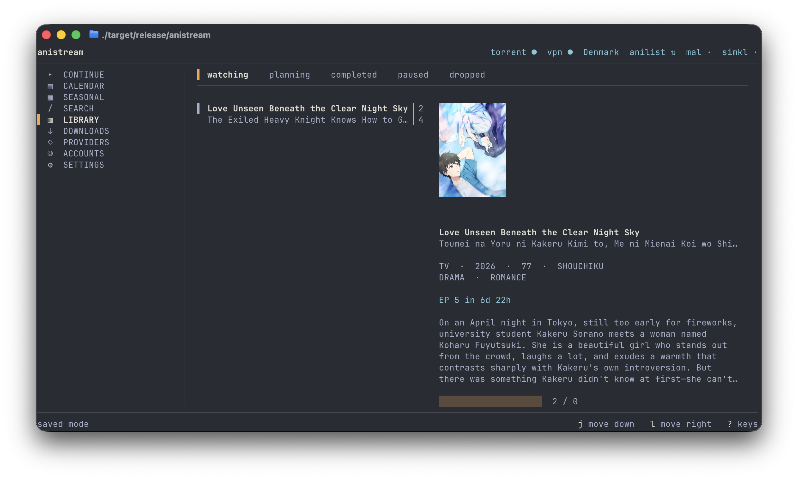
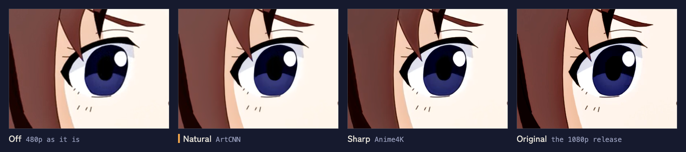
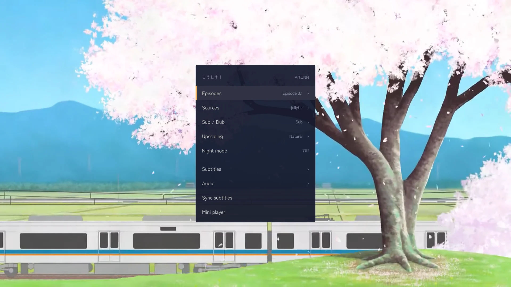
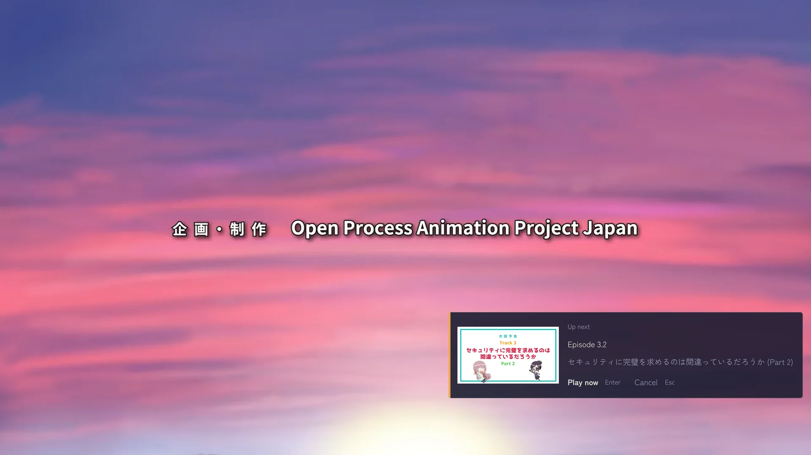
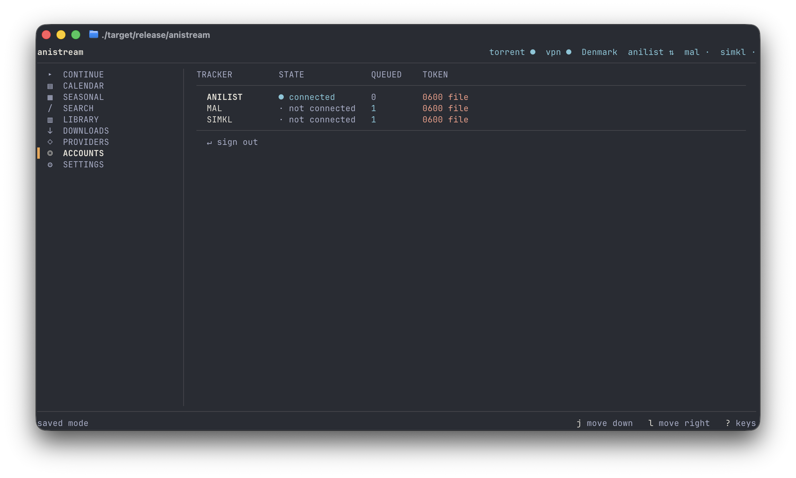
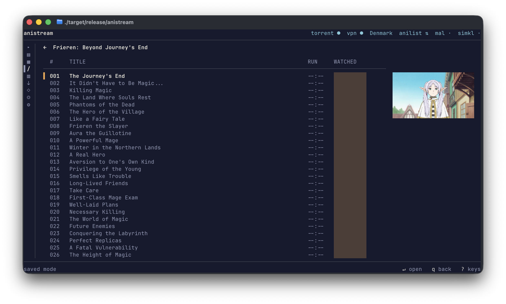
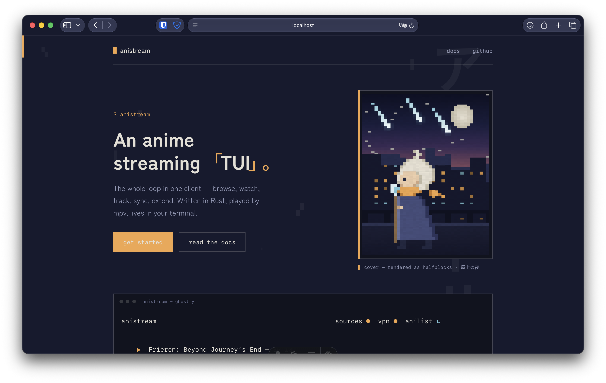

# anistream

An anime streaming TUI. Real image rendering, mpv for playback, pluggable everything.



## Features

Browsing, search and seasonal lists run off AniList and need no account. When AniList cannot
answer, metadata falls back to Tenrai — MyAnimeList's mirror, translated home through the ID
mapping — and only then to what was last cached, so an outage degrades browsing but can never
stop an episode you have watched before from playing. Fresh first, always; one quiet toast says
when the ladder moved and when it moved back. Watch history is local
SQLite. Playback is mpv in the app's own look: seekbar thumbnails, a skip button, Up Next and
menus, one window for a whole binge, and upscaling that adapts to the source and the GPU.
Search filters server-side — genre, year, season, format, status, sort — from one overlay on
`ctrl+f`, and a title screen offers its watch order, its recommendations and its trailer.

The home screen keeps a half-finished episode with its position, and the calendar spans a week
either side of today so what just aired is as visible as what is coming. On launch, one quiet
toast says what aired for shows you watch since you were last here — a digest, never a ping, and
`[notifications] desktop = true` copies it to the desktop for launch-and-switch-away sessions.

`anistream --continue` resumes the most recent episode with no TUI at all, and
`anistream --play <id>` plays a title's next unwatched episode straight from the shell.



### Inside the player



| | |
| --- | --- |
|  |  |
| Thumbnails on the seek bar, subtitles moved above it | Episodes, sources, sub or dub, upscaling and tracks |
|  |  |
| The opening, from the file's own chapters | Up Next at the ending, in the same window |

<sub>Player frames from こうしす！ #3.1 by [OPAP-JP contributors](https://opap.jp/), and the
comparison from [Sol Levante](https://opencontent.netflix.com/) by Netflix and Production I.G, both
licensed [CC BY 4.0](https://creativecommons.org/licenses/by/4.0/); see
[their notice](assets/screenshots/NOTICE.md).</sub>

Torrent streaming uses librqbit, plays while downloading and is seekable. You supply the indexer.
It sits behind a fail-closed VPN guard and is unreachable without one. There is a downloads screen
for what you have pulled down, and completed files get their subtitles muxed in.

Sources are pluggable three ways: the torrent transport, a self-hosted Consumet-shaped API through
the `remote` provider, and sandboxed WASM plugins in any WASI 0.2 language. `P` pins a source for
one title, and the Sources overlay picks an exact release of an episode.

Tracker sync covers AniList, MyAnimeList, Kitsu, Simkl and Trakt through an outbox that survives
being offline. `a` sets a title's list status and `*` rates it out of ten; both queue like
progress does, so rating is always yours to reach for and never a prompt in your way. Filler and
recap episodes are marked from AnimeFillerList. Discord rich presence reports what you are
watching.

anistream will not work around DRM: where a licensed catalogue is integrated at all, it will be
as a link that opens in that service.

## Install

Every [release](https://github.com/bitknox/anistream/releases) ships ready to run, with no toolchain
and no build step:

| System | Download |
| --- | --- |
| macOS | `anistream-<version>-aarch64-apple-darwin.pkg` for Apple silicon, `…-x86_64-apple-darwin.pkg` for Intel, or the `.tar.gz` for `PATH`-only installs |
| Windows | `anistream-<version>-setup.exe`, or the `.zip` |
| Debian, Ubuntu | `anistream-<version>-amd64.deb`, or the `.tar.gz` |
| Other Linux | The `.AppImage`: `chmod +x`, then run it from a terminal |

The Linux builds need glibc 2.28 or newer: Debian 10, Ubuntu 20.04, RHEL 8 or later.

The installers put `anistream` on your `PATH` and add a launcher. The archives hold the binary,
this README, the licence and a `third-party` folder of notices. Every asset has a `.sha256` beside
it. The builds are not code-signed yet. The first time, macOS wants **Open Anyway** in System
Settings → Privacy & Security for the `.pkg`, or `xattr -d com.apple.quarantine anistream` for the
archive's binary, and Windows SmartScreen wants **More info → Run anyway**.

mpv and ffmpeg are not bundled, so install those first (`brew install mpv ffmpeg`,
`winget install shinchiro.mpv Gyan.FFmpeg`, or your distro's packages; the `.deb` pulls them in
as dependencies). The player's own interface (skip button, Up Next, menus, thumbnails) needs mpv
0.36 or newer. Older versions play with mpv's own controls, and `anistream --doctor` says which
you have.

### Updating

```sh
anistream --update
```

Downloads the latest release, verifies its published SHA-256, and replaces the binary in place.
The app also checks for new releases once a day and mentions one in a toast; `check = false`
under `[updates]` turns that off.

## Build from source

Prebuilt binaries make the rest of this section optional.

macOS:

```sh
brew install mpv ffmpeg cmake      # cmake is for wreq's BoringSSL
rustup toolchain install 1.97.1    # pinned by rust-toolchain.toml
```

Windows:

```powershell
winget install --id Rustlang.Rustup
winget install --id Kitware.CMake
winget install --id NASM.NASM                              # aws-lc-sys assembles its own crypto
winget install --id Gyan.FFmpeg
winget install --id shinchiro.mpv
winget install --id Microsoft.VisualStudio.2022.BuildTools # "Desktop development with C++"
```

Add `rustup target add wasm32-wasip2` if you want to build plugins.

## Quick start

```sh
anistream                  # from an installer or archive
cargo run --release        # from a source checkout
```

You get browsing straight away, with no account and no config. Everything below is optional.

Use a terminal with a graphics protocol if you can — Ghostty, Kitty, iTerm2, WezTerm. Elsewhere it
falls back to halfblocks. `anistream --doctor` reports what yours supports.

## Configuration

Config lives at `~/.config/anistream/config.toml`, or `~/Library/Application Support/anistream/config.toml`
on macOS. Every section is optional.

```toml
[theme]
mode = "adaptive"      # inherit the terminal's background, or "immersive" for dusk indigo

[playback]
translation = "sub"
quality = 1080
commit_threshold = 0.85    # fraction of runtime that counts as watched and gets synced
auto_next = true
skip_opening = true        # skips it, with an Undo on the video
mark_chapters = true       # puts the opening and ending on the seek bar
upscaling = "natural"      # "natural" (ArtCNN), "sharp" (Anime4K) or "off"
player_ui = "anistream"    # or "mpv" to keep your own mpv setup

[notifications]
airing_digest = true       # one toast on launch: what aired for shows you watch
desktop = false            # copy that toast to the desktop too

[meta]
fallback = true            # tenrai when anilist cannot answer, cache when neither can

[providers]
order = ["torrent", "plugins"]    # tried in order; failover walks the list
```

### Torrenting and the VPN guard

anistream gives you the torrent transport: a librqbit session behind the VPN guard, streamed over
loopback HTTP. It gives you no index of what to fetch. There is no built-in indexer and no default
endpoint, so the search URL, the trackers and any curation service are yours to supply, and the
source stays inert until they are.

Torrent traffic exposes your IP to every peer in the swarm, so none of this turns on until you pick
a VPN mode and the guard passes.

```toml
[providers.torrent]
enabled = true

# Required. `{query}` is replaced with the URL-encoded search terms; a template without it
# gets `q=` appended. Any RSS feed whose items carry seeders and an info hash will do —
# tag names are matched by local name, so the namespace does not matter.
rss_url = "https://your-indexer.example/?page=rss&q={query}"

# Required in practice: proxy mode disables DHT, so without trackers there are no peers.
trackers = [
  "udp://tracker.example:1337/announce",
  "udp://other.example:6969/announce",
]

# Optional. Answers "which release of this is the good one?", keyed on the AniList id. Picks
# pointing anywhere other than your indexer are ignored, since they cannot be played.
curation_url = "https://your-curation.example/api/records?filter=(alID={anilist_id})&expand=trs"

[providers.torrent.vpn]
mode = "socks5"                            # "socks5" | "external" | "none"
socks_url = "socks5://10.64.0.1:1080"      # Mullvad's in-tunnel endpoint
mullvad_exit = true                        # or require_asn_org = ["31173"]
verify_interval_secs = 60
on_leak = "pause"
```

The guard routes the session through your VPN's SOCKS5 proxy and forces DHT off. It verifies
egress through the proxy before any session starts, re-checks on an interval, and pauses every
torrent if a check fails.

This is application-level containment, not kernel-enforced. Add your VPN's kill switch for a real
guarantee (`mullvad lockdown-mode set on`; `anistream --doctor` reports whether it is on). An
in-tunnel proxy address like Mullvad's `10.64.0.1` is only reachable through the tunnel, so a
dropped tunnel fails closed instead of leaking.

### Trackers

Local history needs no account. Sync is opt-in, and each service except Kitsu needs an app you
register yourself. There is no public client to borrow, and credentials shipped in an open-source
binary would not stay secret. Kitsu is the exception because its token endpoint takes your
account credentials directly — nothing to register, nothing to ship — so it is enabled by
default and sits on the Accounts screen one sign-in away. Enabled is visibility, not activity:
nothing is queued and nothing is pulled for any tracker until it has credentials.

```toml
[trackers]
enabled = ["anilist", "mal", "kitsu", "simkl", "trakt"]   # default: ["kitsu"]
token_storage = "keychain"    # or "file" — see below

[trackers.anilist]
client_id = "…"
client_secret = "…"           # required: AniList has no PKCE and no public client

[trackers.mal]
client_id = "…"               # that is all: MAL is a public client, PKCE covers it

# kitsu needs no section at all

[trackers.simkl]
client_id = "…"               # an OAuth 2.0 app, or an older one that signs in by PIN

[trackers.trakt]
client_id = "…"
client_secret = "…"           # Trakt wants one on the token exchange
```

|                | AniList                                             | MyAnimeList                                                               | Kitsu                              | Simkl                                             | Trakt                                           |
| -------------- | --------------------------------------------------- | ------------------------------------------------------------------------- | ---------------------------------- | ------------------------------------------------- | ----------------------------------------------- |
| Register at    | [anilist.co](https://anilist.co/settings/developer) | [myanimelist.net](https://myanimelist.net/apiconfig) — App Type **other** | nowhere — no app exists            | [simkl.com](https://simkl.com/settings/developer) | [trakt.tv](https://trakt.tv/oauth/applications) |
| Sign-in flow   | browser redirect                                    | browser redirect                                                          | username + password, once          | device code                                       | device code                                     |
| Redirect URL   | `http://127.0.0.1:45617/callback`                   | `http://127.0.0.1:45617/callback`                                         | none needed                        | none needed                                       | none needed                                     |
| Needs a secret | yes                                                 | no                                                                        | no                                 | no                                                | yes                                             |
| Token life     | ~1 year                                             | ~31 days, refreshed automatically                                          | ~30 days, refreshed automatically  | 7 days, refreshed automatically                   | ~3 months, then --login again                         |

Then run `anistream --login`, or `anistream --login --tracker mal`. Simkl and Trakt use the OAuth
device flow, so `--login --tracker simkl` prints a code and a URL to enter it at. Kitsu signs in
right on the Accounts screen — Enter on its row asks for your username and a masked password,
exchanges them for a token and drops them; `--login --tracker kitsu` does the same from a shell
for headless machines. The password is never stored and never rendered. Check any of them with
`anistream --sync`.



Use `keychain` for `token_storage` on an installed build. Use `file`, which is `0600`, if you are
running from `cargo`: macOS keys keychain access on the binary, and every rebuild produces a new
one, so "Always Allow" never sticks and every run prompts you. `anistream --token-to-file` moves an
existing token across, and `ANISTREAM_TOKEN_STORAGE=file` overrides for a single run.

To check an indexer of your own end to end:

```sh
cargo run -p anistream-providers --example torrent_probe -- \
    'https://your-indexer.example/?page=rss&q={query}'
```

## Command line

None of these start the interface, and one runs at a time. Most answer and exit; `--stream-url`
and `store serve` keep running until you stop them. `--search`, `--stats` and `--random` also take
`--json`.

|                                                     |                                                                                                                            |
| --------------------------------------------------- | -------------------------------------------------------------------------------------------------------------------------- |
| `--doctor`                                          | Terminal support, mpv and its config, datasets, configured indexer, VPN guard, kill-switch state                           |
| `--search <query>`                                  | Search AniList                                                                                                             |
| `--continue`                                        | Resume the most recent episode, or start the next one — the full session, no TUI                                          |
| `--play <id> [--episode N]`                         | Play one title headlessly; without `--episode` it takes the next unwatched                                                 |
| `--stats`                                           | Watch statistics                                                                                                           |
| `--export <path>` \| `--import <path>`              | History as JSON; `-` for stdio                                                                                             |
| `--random`                                          | Pick something from your history                                                                                           |
| `--login [--tracker mal]` \| `--logout` \| `--sync` | Tracker accounts                                                                                                           |
| `--login-url --tracker anilist`                     | Print the authorize URL and exit, for signing in on another machine                                                        |
| `--plugins`                                         | Installed plugins and what each may reach                                                                                  |
| `store serve <dir> --url <address>`                 | Run a plugin store for people you invite; `store invite`, `store publish` and `store admin` do the owner's jobs from the store's machine |
| `plugin stamp <file.wasm> [-o <out>]`               | Write a plugin's manifest into it, for stores that cannot run plugins                                                      |
| `--stream-url <id> [--episode N]`                   | Resolve one episode to a URL and hold it open, so `mpv` or `curl` can be pointed at it                                     |
| `--preview 120x34 --screen home`                    | Render one screen as text: home, calendar, seasonal, search, library, downloads, providers, accounts, settings, title, episodes, help, palette |
| `--refresh-data`                                    | Refresh the ID-mapping datasets                                                                                            |

`--theme adaptive|immersive` and `--no-images` override presentation for one run without touching
`config.toml`.

## Matching titles

A torrent source has no catalogue, so titles are matched by name, and two releases sometimes score
within a point of each other. When that happens the episodes screen asks instead of failing:
candidates are listed best-first with the score each got and why any was passed over, and `↵` picks
one. The choice is stored as an override that the resolution ladder checks first, so you are only
asked once.



## Watched versus resumable

`commit_threshold`, 85% by default, decides when an episode counts as watched and gets pushed to a
tracker. It is set high so that opening an episode to check the subtitles does not mark it seen.

Resuming is separate. Quit an episode any time past thirty seconds and it shows up on the home
screen with its position, since quitting halfway is a clear signal you mean to come back. Only past
95% is an episode treated as too close to the end to resume.

## When playback fails

```sh
anistream --doctor                        # does mpv run, and which config is it reading
anistream --stream-url 154587 --episode 1 # resolve one episode, print the URL, keep it served
```

`--stream-url` separates the two failure modes. If `mpv --no-config <that url>` plays, the problem
is in anistream. If it does not, it is the player or the source, and mpv says which. anistream
captures mpv's stderr and surfaces the relevant line.

Plugins compile in the background and are cached, so they never hold up the first frame; a large
one, such as the JavaScript reference plugin, joins the sources a second or so after a fresh
install. `--plugins` lists what is installed; drop `"plugins"` from `providers.order` if you do not
use them.

## Plugins

Provider plugins are WebAssembly components in any language targeting WASI 0.2 — see
**[docs/plugins.md](docs/plugins.md)**. The sandbox has no sockets; the host lends `fetch`, so a
plugin is a parser. `anistream --plugins` shows what each installed plugin may contact, and that
list is enforced host-side. Per-plugin settings live under `[providers.plugins.settings.<id>]`.

Plugins can also be shared through a plugin store: a small server that someone runs for the people
they invite. Paste an invite link under **Providers** to join one, then install from its list.
anistream lists no stores of its own. [deploy/](deploy/README.md) has one-click templates for
running a store on Cloudflare, Vercel, Netlify, Render, Heroku, Fly or Railway, or on a machine of
your own, and **[docs/plugin-stores.md](docs/plugin-stores.md)** covers running one and the
protocol.

## Architecture

Eighteen crates. The app's, volatility increasing left to right:

```
 AniList        ID mapping        Provider         Player
 (stable)  ──►  (stable glue) ──► (volatile)  ──►  (stable)
                     │                                │
                     │                                ▼
                     │                    History (SQLite, local)
                     └──────────────────►  source of truth, offline
                      ids for every tracker           │
                                                      ▼
                                            Trackers (pluggable)
```

`anistream-core` (types and traits) · `-net` (HTTP, rate limiting) · `-meta` (AniList, Tenrai failover, ID mapping,
filler) · `-store` (SQLite) · `-providers` (torrent transport, remote, mock) · `-player` (mpv IPC) ·
`-track` (AniList, MAL, Kitsu, Simkl, Trakt, sync) · `-plugin` (WASM host) · `-model` (the protocol
between the engine and a front end, and its wording) · `-engine` (playback, sources, sync, downloads
and the background jobs) · `-tui` (the terminal front end, ratatui) · `anistream` (the binary: the
command line, the terminal's event loop, and the wiring from front end to engine) · `-ffi` (the
engine for native front ends, through UniFFI; the Swift package is in `apple/`) · `-testkit` (a
fake AniList and goldens, for tests).

Plugin stores have four of their own: `-store-core` (the protocol, the store's rules and its admin
page, built natively and to WebAssembly) · `-plugin-store` (the client and the reference server) ·
`-store-server` (`anistream store …` and the standalone `anistream-store`) · `-store-wasm` (the
store for Workers and serverless functions). `-store` is the app's own history, and unrelated.

Sources decay, so every volatile piece sits behind a trait and the core never depends on one.

The engine and the model use no terminal library, so a front end that is not a terminal can run
on them. The terminal front end depends on the model, not the engine, and the binary connects
the two. `tools/check-boundaries.sh` checks both rules in CI.

## Development

```sh
cargo test --workspace        # no network
cargo clippy --workspace --all-targets
cargo test -p anistream-tui --test goldens    # every screen against its saved golden
```

The website and docs are in `website/` (Astro + Starlight): `cd website && bun run dev`.



There are also live probes. They need real services and are not part of `cargo test`:

```sh
cargo run -p anistream-providers --example stream_probe          # torrent path through the VPN
cargo run -p anistream-engine --example playback_probe           # torrent → mpv → history
cargo run -p anistream-engine --example sync_probe -- --write    # AniList push, then undo
cargo run -p anistream-engine --example mal_probe -- --write     # MAL push, then undo
cargo run -p anistream-engine --example kitsu_probe -- --write   # Kitsu push, then undo; no args = public wire check
cargo run -p anistream-engine --example meta_probe               # Tenrai translation and the cache write-through
cargo run -p anistream-engine --example simkl_probe -- --write   # Simkl push, then undo
cargo run -p anistream-engine --example mend_probe -- <url>      # disguised HLS → mpv
cargo run -p anistream --example player_preview -- <video>       # the player UI as a two-episode binge
cargo run -p anistream-meta --example filler_probe               # filler parsing
cargo run -p anistream-meta --example episode_meta_probe         # episode titles, stills, numbering
cargo run -p anistream-engine --example episodes_probe           # every stage from title to stream
cargo run -p anistream-engine --example continue_probe           # resume vs. sync thresholds
```

## Scope

The metadata, mapping, player, tracker and plugin layers use documented public APIs. anistream
hosts no content and ships no catalogue of its own. The torrent source is a transport; what you
point any source at is your configuration, and the responsibility that comes with it is yours.
Torrenting is off by default and gated behind the VPN guard, and every source is a config edit away
from being removed. anistream will not circumvent DRM.

MIT.
