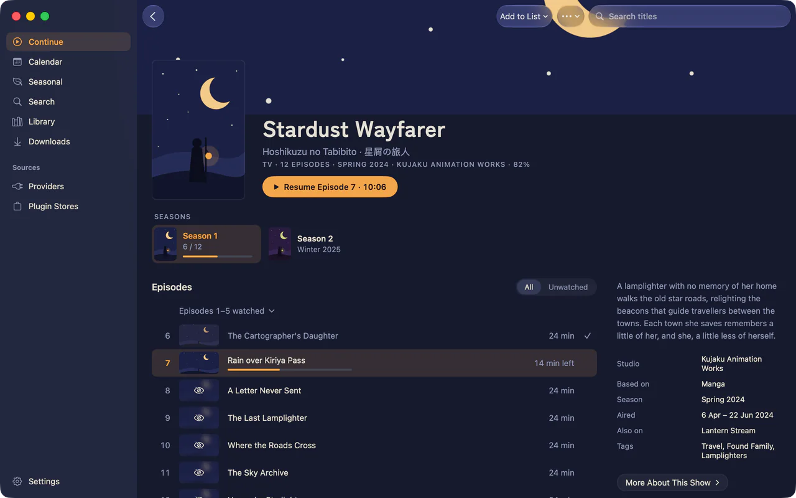

# anistream

anistream is an anime client for Mac, iPhone, iPad and Android, and for the terminal on macOS,
Linux and Windows. It browses AniList with no account, plays episodes in mpv, keeps your history
on your device and syncs it to AniList, MyAnimeList, Kitsu, Simkl and Trakt. The apps and the
terminal app run the same Rust engine.



anistream hosts no content.

## Download

Every release on the [releases page](https://github.com/bitknox/anistream/releases/latest) has the
apps and the terminal app. Each file has a `.sha256` beside it. The apps are not in the App Store
or on Google Play, so each one needs a one-time step the first time you open it. The
[installation guide](https://anistream.tv/docs/getting-started/installation/) has the full steps.

| Platform | File | First open |
| --- | --- | --- |
| Mac, macOS 26 or later, Apple silicon | `anistream-<version>-macos.dmg` | Drag Anistream to Applications. The app is ad-hoc signed and not notarized, so macOS stops it once. Choose **Done**, then open **System Settings › Privacy & Security** and choose **Open Anyway**. |
| iPhone and iPad, iOS or iPadOS 26 or later | `anistream-<version>-ios-unsigned.ipa` | Add the source below in [SideStore](https://sidestore.io) or [AltStore](https://altstore.io), then install anistream from it. They sign the app with your own Apple ID. |
| Android 15 or later, 64-bit ARM | `anistream-<version>-android-arm64.apk` | Open the APK on the device and allow installs from your browser or file manager once. |
| Terminal app | See below | See below |

The SideStore and AltStore source address, for **Sources** › **+**:

```
https://github.com/bitknox/anistream/releases/latest/download/sidestore.json
```

The terminal app comes as an installer or an archive for each system:

| System | Files |
| --- | --- |
| macOS | `anistream-<version>-aarch64-apple-darwin.pkg` (Apple silicon), `anistream-<version>-x86_64-apple-darwin.pkg` (Intel), or the `.tar.gz` of either |
| Windows | `anistream-<version>-setup.exe`, or `anistream-<version>-x86_64-pc-windows-msvc.zip` |
| Debian, Ubuntu | `anistream-<version>-amd64.deb` |
| Other Linux | `anistream-<version>-x86_64.AppImage`: `chmod +x`, then run it from a terminal. The `x86_64-unknown-linux-gnu.tar.gz` holds the binary alone. |

The Linux builds need glibc 2.28 or newer. The terminal app drives mpv and ffmpeg, which are not
bundled: install them first (`brew install mpv ffmpeg` on macOS). The apps have mpv built in. The
terminal app is not code-signed, so macOS and Windows ask you to allow it once; the installation
guide says how.

### Updates

The apps check GitHub for a new release once a day and say when one is out. Nothing is downloaded
until you choose to update, and an update keeps your history and settings. On the Mac, the app
downloads the release, checks its signature and replaces itself. On Android, it downloads the APK,
checks it and installs it over the old one. On iPhone and iPad, the notice opens SideStore or
AltStore with anistream's source. The terminal app updates with `anistream --update`.

## Sources and plugin stores

anistream finds episodes through sources. A source is a sandboxed WebAssembly plugin, a JSON API
you host yourself, or the torrent transport, which has nothing to search until you supply an
endpoint. A plugin can only reach the hosts it declares. anistream never works around DRM: a
licensed stream opens in its own service.

A plugin store is a small server that one person runs for the people they invite. Everyone who
joins can install the store's plugins from inside anistream and hears about new versions. Each
device gets its own token, and every plugin list is signed with the store's key. anistream ships
no store and lists none, so every store you see is one someone sent you. See
[plugin stores](https://anistream.tv/docs/plugins/stores/),
[running a store](https://anistream.tv/docs/plugins/running-a-store/) and
[writing a plugin](https://anistream.tv/docs/plugins/authoring/).

anistream hosts no content. Which sources you use, and what you point them at, is your own
decision.

## Build from source

The Rust toolchain version is pinned in `rust-toolchain.toml`, and `rustup` installs it. For the
terminal app, install mpv and ffmpeg, and cmake for the TLS library, then:

```sh
cargo run --release                      # the terminal app, from a checkout
cargo test --workspace                   # no network
cargo clippy --workspace --all-targets
```

- Mac, iPhone and iPad: [apple/README.md](apple/README.md). It needs Xcode 26, XcodeGen and an
  Apple silicon Mac.
- Android: [android/README.md](android/README.md). It needs Android Studio, the NDK, `cargo-ndk`
  and the `aarch64-linux-android` target.
- Plugins: `rustup target add wasm32-wasip2`, then see [docs/plugins.md](docs/plugins.md).
- The website: `cd website && bun run dev`.

## Project layout

| Folder | What it holds |
| --- | --- |
| `crates/` | The Rust workspace: the engine, the terminal app, the trackers, the plugin sandbox, the plugin store and the FFI layer the apps use. See [crates/CLAUDE.md](crates/CLAUDE.md). |
| `apple/` | The SwiftUI app for Mac, iPhone and iPad |
| `android/` | The Kotlin and Compose app for Android |
| `plugins/` | Example plugins in Rust and TypeScript |
| `wit/` | The interface plugins are written against |
| `deploy/` | Ways to run a plugin store: containers and serverless hosts |
| `packaging/` | Release builds, installers and the release scripts |
| `website/` | The website and docs, in Astro and Starlight |
| `docs/` | Design notes for plugins, plugin stores and Android |
| `assets/` | Icons, shaders and the images used in the docs |
| `tools/` | Checks and helper scripts for the workspace |

## Links

- Website: [anistream.tv](https://anistream.tv)
- Apps: [anistream.tv/apps](https://anistream.tv/apps/)
- Docs: [anistream.tv/docs](https://anistream.tv/docs/)
- Privacy: [what anistream sends and what it keeps on your device](https://anistream.tv/docs/privacy/)
- Releases: [github.com/bitknox/anistream/releases](https://github.com/bitknox/anistream/releases)
- Security: [SECURITY.md](SECURITY.md)

## Licence

anistream is open source under the [MIT licence](LICENSE), for non-commercial use. Notices for
what it bundles are in [assets/THIRD-PARTY.md](assets/THIRD-PARTY.md) and ship with each release.
