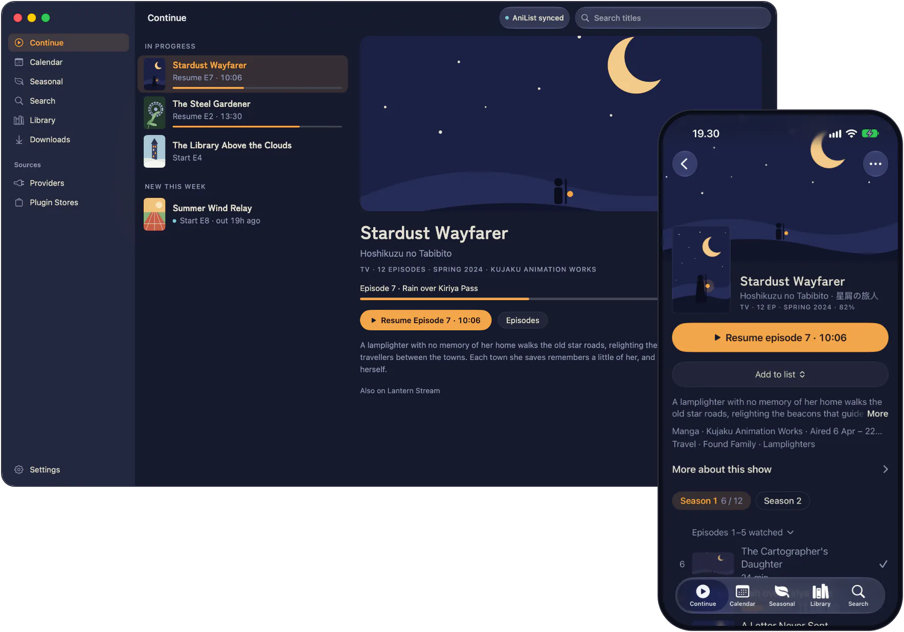
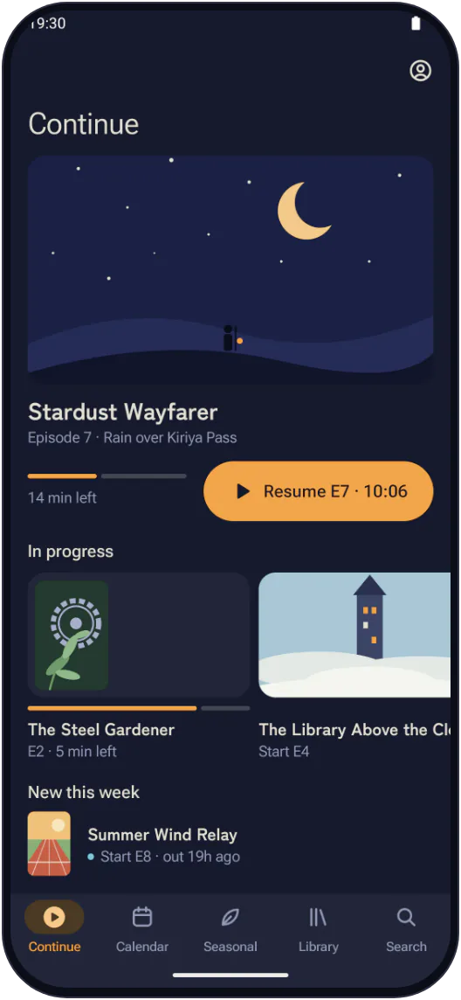
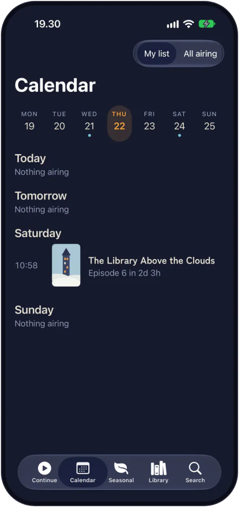
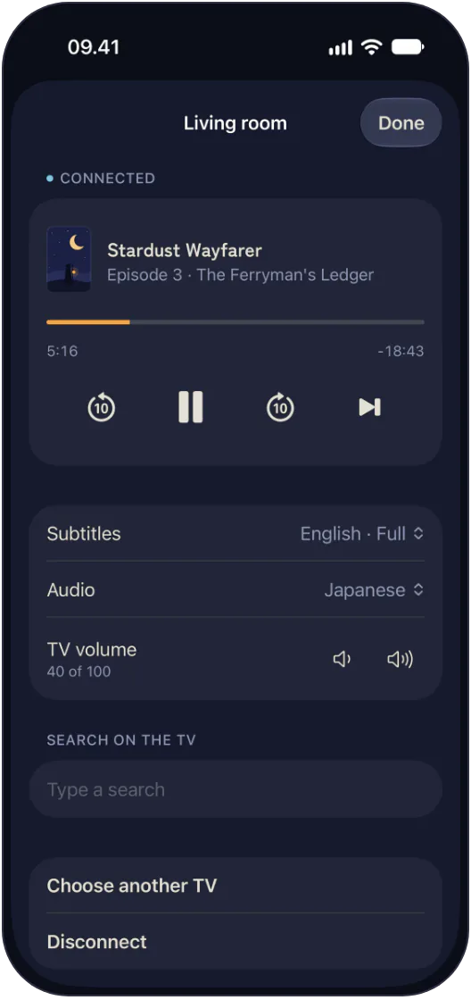
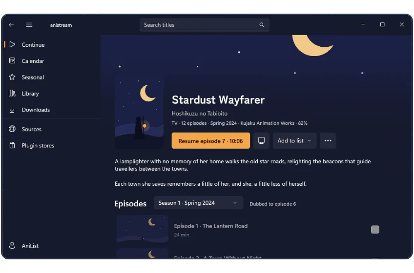
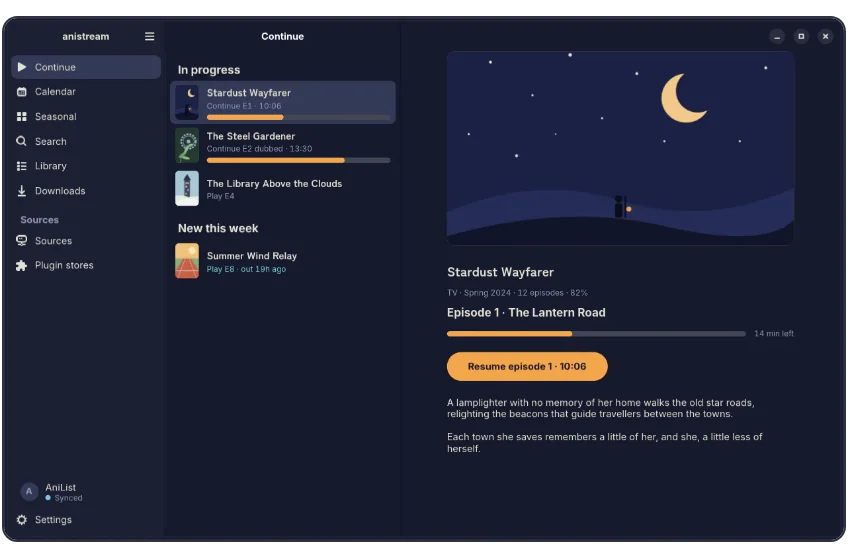
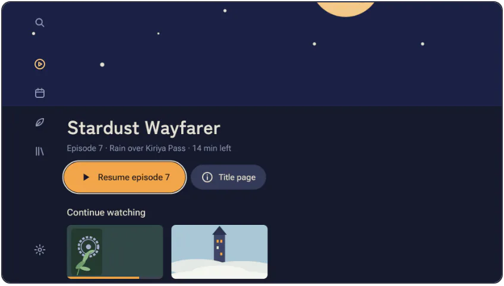
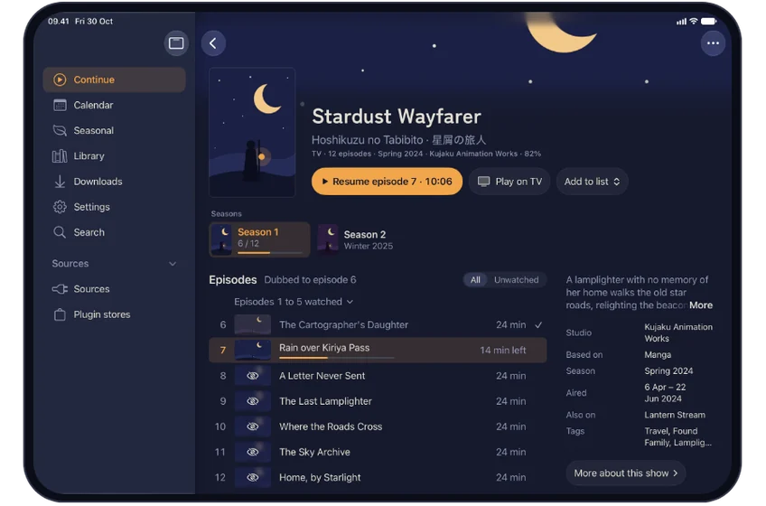
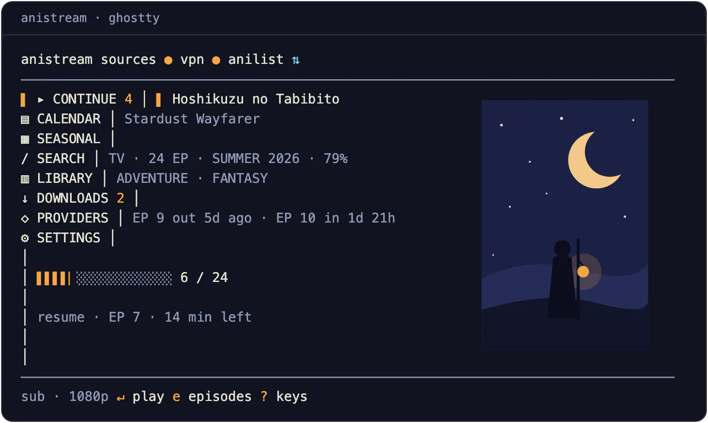
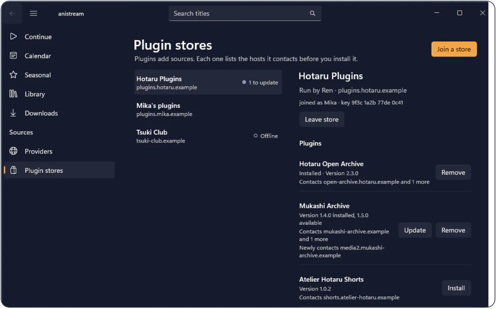

<div align="center">

<a href="https://anistream.tv">
  <picture>
    <source media="(prefers-color-scheme: dark)" srcset="docs/assets/readme/wordmark-dark.webp">
    <source media="(prefers-color-scheme: light)" srcset="docs/assets/readme/wordmark-light.webp">
    
  </picture>
</a>

<h3>Browse, watch, track and sync anime in one client.</h3>

<p>
Native apps for Mac, iPhone, iPad, Android, Android TV, Windows and Linux, and one for the terminal.
<br>
anistream hosts no content and supplies no sources.
</p>

<p>
<a href="https://github.com/bitknox/anistream/releases/latest">Download</a>
&nbsp;·&nbsp;
<a href="https://anistream.tv/apps/">Apps</a>
&nbsp;·&nbsp;
<a href="https://anistream.tv/features/">Features</a>
&nbsp;·&nbsp;
<a href="https://anistream.tv/docs/">Docs</a>
&nbsp;·&nbsp;
<a href="https://anistream.tv/docs/privacy/">Privacy</a>
</p>

<p>
<a href="https://github.com/bitknox/anistream/releases/latest"></a>
<a href="LICENSE"></a>
</p>

<br>



<sub>The Mac and iPhone apps. Every title and picture here is made up.</sub>

</div>

<br>

anistream browses AniList with no account, plays episodes in mpv, keeps your history on your
device and syncs it to AniList, MyAnimeList, Kitsu, Simkl and Trakt. It is free, open source and
non-commercial. anistream hosts no content and supplies no sources: you add the ones you are
entitled to use.

<table>
  <tr>
    <td width="33%" align="center" valign="top">
      
      <br><br>
      <b>Continue watching</b>
      <br>
      The shows you're partway through, with the next episode ready to play.
    </td>
    <td width="33%" align="center" valign="top">
      
      <br><br>
      <b>Calendar and sync</b>
      <br>
      See what airs each day. Your progress syncs to AniList, MyAnimeList, Kitsu, Simkl and Trakt.
    </td>
    <td width="33%" align="center" valign="top">
      
      <br><br>
      <b>Play on TV</b>
      <br>
      Send an episode to the Android TV app, then use your phone or computer as the remote.
    </td>
  </tr>
</table>

Also in the apps:

- Skip the opening, and start the next episode from the credits.
- Pick sub or dub once and each show remembers.
- The next episodes of your shows download ahead of time, and a downloaded episode resumes and
  syncs like a stream.
- Watch with friends in sync, on Mac, iPhone, iPad, Windows, Linux and in the terminal.
- New-episode alerts, off until you turn them on for a show.
- Home screen widgets, and Live Activities and Handoff on Apple devices.

The [features page](https://anistream.tv/features/) lists every feature and which app has it.

## Apps

Each app is built with its platform's toolkit: SwiftUI on Apple, Jetpack Compose on Android,
WinUI 3 on Windows, GTK 4 on Linux and Ratatui in the terminal. They share one engine, written in
Rust.

<table>
  <tr>
    <td width="50%" align="center" valign="top">
      
      <br>
      <sub>Windows</sub>
    </td>
    <td width="50%" align="center" valign="top">
      
      <br>
      <sub>Linux</sub>
    </td>
  </tr>
</table>

<table>
  <tr>
    <td width="50%" align="center" valign="top">
      
      <br>
      <sub>Android TV</sub>
    </td>
    <td width="50%" align="center" valign="top">
      
      <br>
      <sub>iPad</sub>
    </td>
  </tr>
</table>

### The player

Episodes play in mpv, upscaled by ArtCNN or Anime4K, with a skip button for the opening and Up
Next at the end. The player menu has the episodes, sources, sub or dub, upscaling and tracks.


<sub>The player frame is from こうしす！ #3.1 by OPAP-JP contributors, licensed
<a href="https://creativecommons.org/licenses/by/4.0/">CC BY 4.0</a>. See
<a href="assets/screenshots/NOTICE.md">the notice</a>.</sub>

### The terminal app

anistream also runs in a terminal on macOS, Linux and Windows. On a Mac it shares its history and
config with the Mac app. Covers show as images in Ghostty, Kitty, iTerm2, WezTerm and other
terminals with image support.

<p align="center">

</p>

## Download

Every release on the [releases page](https://github.com/bitknox/anistream/releases/latest) has the
apps and the terminal app. Each file has a `.sha256` beside it. The apps are not in the App Store
or on Google Play, so each one needs a one-time step the first time you open it. The
[installation guide](https://anistream.tv/docs/getting-started/installation/) has the full steps.

| Platform | File | First open |
| --- | --- | --- |
| Mac, macOS 26 or later, Apple silicon | `anistream-<version>-macos.dmg` | Drag Anistream to Applications. The app is ad-hoc signed and not notarized, so macOS stops it once. Choose **Done**, then open **System Settings › Privacy & Security** and choose **Open Anyway**. |
| iPhone and iPad, iOS or iPadOS 26 or later | `anistream-<version>-ios-unsigned.ipa` | Add the source below in [SideStore](https://sidestore.io) or [AltStore](https://altstore.io), then install anistream from it. They sign the app with your own Apple ID. |
| Android 15 or later, 64-bit ARM | `anistream-<version>-android-arm64.apk` | Open the APK on the device and allow installs from your browser or file manager once. |
| Android TV and Google TV, Android 11 or later, 32-bit or 64-bit ARM | `anistream-<version>-android-tv.apk` | Install it with a sideloading app or `adb install`. |
| Windows 10 version 2004 or later, x64 or Arm64 | `anistream-<version>-windows-x64-setup.exe` or `anistream-<version>-windows-arm64-setup.exe` | The installer is not signed: in SmartScreen, choose **More info**, then **Run anyway**. |
| Linux with glibc 2.41 or newer (Ubuntu 25.04 or later, including 26.04 LTS, Fedora 42 or later, Debian 13), x86-64 or ARM64 | `anistream-<version>-linux-x86_64.AppImage` or `anistream-<version>-linux-aarch64.AppImage` | `chmod +x`, then open it. Ubuntu 24.04 is not supported. |

The SideStore and AltStore source address, for **Sources** › **+**:

```
https://github.com/bitknox/anistream/releases/latest/download/sidestore.json
```

<details>
<summary>The terminal app</summary>

<br>

The terminal app comes as an installer or an archive for each system:

| System | Files |
| --- | --- |
| macOS | `anistream-<version>-aarch64-apple-darwin.pkg` (Apple silicon), `anistream-<version>-x86_64-apple-darwin.pkg` (Intel), or the `.tar.gz` of either |
| Windows | `anistream-<version>-setup.exe`, or `anistream-<version>-x86_64-pc-windows-msvc.zip` |
| Debian, Ubuntu | `anistream-<version>-amd64.deb` |
| Other Linux | `anistream-<version>-x86_64.AppImage`: `chmod +x`, then run it from a terminal. The `x86_64-unknown-linux-gnu.tar.gz` holds the binary alone. |

The Linux builds need glibc 2.28 or newer. The terminal app drives mpv and ffmpeg, which are not
bundled: install them first (`brew install mpv ffmpeg` on macOS). The apps have mpv built in. The
terminal app is not code-signed, so macOS and Windows ask you to allow it once; the installation
guide says how.

</details>

<details>
<summary>Updates</summary>

<br>

The apps check GitHub for a new release once a day and say when one is out, and an update keeps
your history and settings. On the Mac, the app downloads the release, checks its signature and
replaces itself. On Android and Android TV, it downloads the APK, checks it and installs it over
the old one. On Windows, it downloads and checks the new installer, then runs it when you choose
Restart to update. On Linux, the AppImage downloads and checks the new version and puts it in
place of the old one. On iPhone and iPad, the notice opens SideStore or AltStore with anistream's
source. The terminal app updates with `anistream --update`.

</details>

## Where episodes come from

anistream hosts no content and supplies, recommends and curates no sources. You add sources you
are entitled to use: a JSON API you host yourself, a stream you have the right to play, a licensed
service, or a sandboxed WebAssembly plugin from a plugin store you joined. A plugin can only reach
the hosts it declares. anistream never gets round DRM: a licensed stream opens in its own service.

A plugin store is a small server that one person runs for the people they invite. Its owner
chooses its plugins and is responsible for them. Everyone who joins can install the store's
plugins from inside anistream and hears about new versions. Each device gets its own token, and
every plugin list is signed with the store's key. anistream ships no store and lists none. You
join one through an invite link. See [Legal and contact](https://anistream.tv/legal/).

<p align="center">

</p>

See [plugin stores](https://anistream.tv/docs/plugins/stores/),
[running a store](https://anistream.tv/docs/plugins/running-a-store/) and
[writing a plugin](https://anistream.tv/docs/plugins/authoring/).

## Build from source

The Rust toolchain version is pinned in `rust-toolchain.toml`, and `rustup` installs it. For the
terminal app, install mpv and ffmpeg, and cmake for the TLS library, then:

```sh
cargo run --release                      # the terminal app, from a checkout
cargo test --workspace                   # no network
cargo clippy --workspace --all-targets
```

- Mac, iPhone and iPad: [apple/README.md](apple/README.md). It needs Xcode 26, XcodeGen and an
  Apple silicon Mac.
- Android and Android TV: [android/README.md](android/README.md). It needs Android Studio, the NDK,
  `cargo-ndk` and the `aarch64-linux-android` target.
- Windows: `desktop/windows`, a .NET solution. See
  [docs/desktop-windows-bindings.md](docs/desktop-windows-bindings.md).
- Linux: `desktop/linux`, a Cargo project with GTK 4 and libadwaita. See
  [docs/desktop-linux-app.md](docs/desktop-linux-app.md).
- Plugins: `rustup target add wasm32-wasip2`, then see [docs/plugins.md](docs/plugins.md).
- The website: `cd website && bun run dev`.
- Claude Code setup and efficient workflows: [docs/claude-code.md](docs/claude-code.md).
- Accessibility: what each app supports and how to report a barrier is in
  [ACCESSIBILITY.md](ACCESSIBILITY.md).

<details>
<summary>Project layout</summary>

<br>

| Folder | What it holds |
| --- | --- |
| `crates/` | The Rust workspace: the engine, the terminal app, the trackers, the plugin sandbox, the plugin store and the FFI layer the apps use |
| `apple/` | The SwiftUI app for Mac, iPhone and iPad |
| `android/` | The Kotlin and Compose apps for Android and Android TV |
| `desktop/` | The WinUI 3 app for Windows and the GTK 4 app for Linux |
| `plugins/` | Example plugins in Rust and JavaScript |
| `wit/` | The interface plugins are written against |
| `deploy/` | Ways to run a plugin store: containers and serverless hosts |
| `packaging/` | Release builds, installers and the release scripts |
| `website/` | The website and docs, in Astro and Starlight |
| `docs/` | Notes on plugins, plugin stores and the apps, and the images in this README |
| `assets/` | Icons, shaders and the images used in the docs |
| `tools/` | Checks and helper scripts for the workspace |

</details>

## Licence

anistream is open source under the [MIT licence](LICENSE). Notices for what it bundles are in
[assets/THIRD-PARTY.md](assets/THIRD-PARTY.md) and ship with each release. Security reports go
through [SECURITY.md](SECURITY.md).

<br>

<p align="center">
<a href="https://anistream.tv"></a>
<br>
<sub>anistream hosts no content and supplies no sources. <a href="https://anistream.tv/legal/">Legal and contact</a></sub>
</p>
